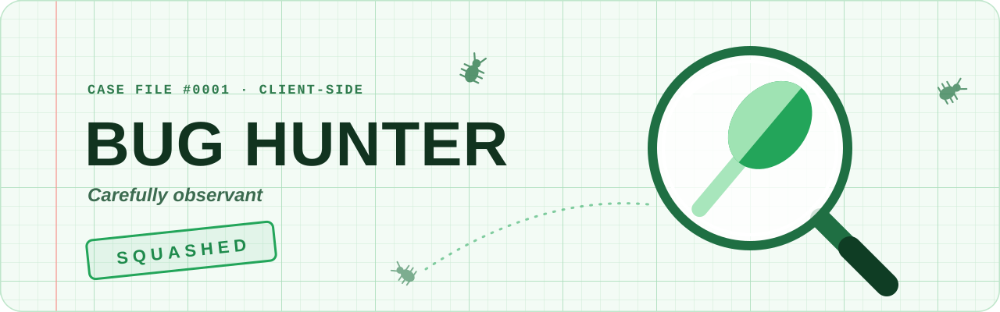

  

<h1 align="center">bug-hunter-badge</h1>

  A client-side script that adds the <b>Bug Hunter</b> badge to your own Discord profile.

---

This is purely for profile decoration. The badge only shows on your own screen. It never touches your account, never reaches Discord's servers, and nobody else can see it.

It shows up wherever your badges do: in your profile's badge row, in the hover tooltip, in the **Your badges** window and in **Customize your badges**.

Not affiliated with Discord.

